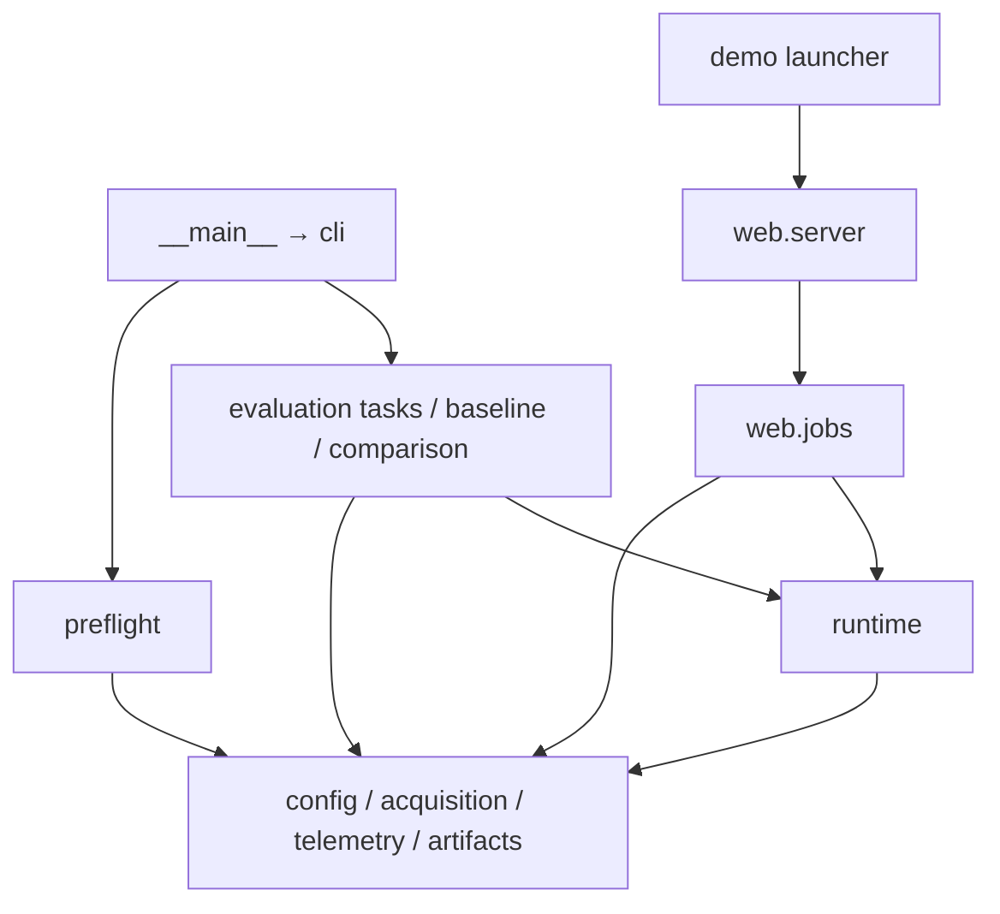

# Single-machine text inference experiment / Demo architecture V1

The CLI and loopback demo reuse configuration validation, acquisition, process ownership, telemetry, and evidence primitives. Evaluation is a separate caller of those modules. The local lab performs bounded experiments; it does not keep a resident model server or coordinate GPU ownership across independent processes.

Resident model ownership, token-aware admission control and recovery of jobs/history after process restart are deferred service work outside V1. The current per-job process lifecycle, request limits and in-memory history define this experiment/Demo architecture.

## Source layout

```text
inference_lab/
  __init__.py
  __main__.py                 # python -m inference_lab
  cli.py                      # CLI command orchestration
  config.py                   # schema version and validated pinned config
  acquisition.py              # verify/download the pinned public artifact
  preflight.py                # read-only diagnostics and preflight command
  runtime.py                  # owned llama-server process group and bounded HTTP
  telemetry.py                # host probes, resource sampling, response metrics
  artifacts.py                # unique run allocation, hashes, exclusive JSON writes
  evaluation/
    __init__.py
    tasks.py                  # dataset, automatic filters, suite, manual review
    baseline.py               # repeated measurements and baseline review
    comparison.py             # evidence validation and single-factor comparison
  demo.py                     # permanent launcher for python -m inference_lab.demo
  web/
    __init__.py
    server.py                 # HTTP routes, static assets, startup/shutdown CLI
    jobs.py                   # serialized variant jobs and cancellation
    static/{index.html,app.js,style.css}
experiments/                  # pinned JSON configs and versioned six-case dataset
results/                      # historical versioned derived results
```

The old flat evaluation modules and `demo_web/` are removed. `demo.py` is an intentional public launcher, with implementation in `web/`. `modal_llama_smoke.py`, contracts/providers and the registered llama.cpp submodule retain their independent deployment roles.

## Dependency direction



`config` validates immutable configuration. `artifacts` uses its schema version; `acquisition` uses artifact hashing; `runtime` uses acquisition, artifacts and telemetry. These shared modules have no evaluation or web imports. `preflight` owns diagnostic orchestration. The CLI can import evaluation; the web manager does not invoke task scoring or baseline comparisons for arbitrary prompts.

## Execution and ownership

A CLI baseline validates the dataset, allocates a unique run directory, verifies model and binary identities, captures source/environment identity in an exclusive pre-start manifest, and starts one owned llama-server process group. It requires observed GPU offload, runs one warmup and six cases twice, samples resources, then stops/reaps that process group before recording cleanup and measurement eligibility. Exact JSON scoring is automatic; summary/code quality remains pending until an independent review binds the exact run and repeated output hashes.

`runtime.LocalServer` owns startup, readiness polling, a hard watchdog, bounded non-stream HTTP, and process-group cleanup. Known readiness HTTP 503 is retried within the deadline. Other HTTP failures retain local raw-response evidence. The server binds loopback and uses one inference slot. Shutdown sends TERM then KILL when necessary, reaps the owned leader, and checks that no live owned group members remain. Other process groups are outside its ownership.

The demo verifies the model/runtime/GPU once at startup. A validated submission writes its manifest before reserving the active slot. One worker loads baseline and/or optimized variants sequentially; each gets a separate owned server, cancellation monitor, sampler and directory. The manager keeps the active reservation through cleanup. Cancellation interrupts the owned group, prevents the next variant, and publishes a terminal run after the cleanup attempt. Unconfirmed cleanup blocks subsequent submissions and retains the owned-server reference and active reservation for inspection.

Resource, raw-response, variant-receipt and final-receipt write errors converge to a terminal failed job; they cannot bypass ownership cleanup or leave variants loading/running. Writers are attempted independently where possible. If disk space or permissions prevent a receipt, in-memory state reports the failure; persistence cannot be promised on an unwritable filesystem. A final-receipt failure may leave successfully completed variant evidence alongside a failed job whose final persistence failed. Successful cleanup permits later jobs; unconfirmed cleanup does not.

```mermaid
sequenceDiagram
  participant Browser
  participant HTTP as web.server
  participant Jobs as web.jobs
  participant Owned as runtime.LocalServer
  Browser->>HTTP: POST /api/runs
  HTTP->>Jobs: validate and submit
  Jobs-->>Browser: 202 job ID
  Jobs->>Owned: start owned process group
  Browser->>HTTP: POST /api/runs/ID/cancel {}
  HTTP->>Jobs: set cancellation event
  Jobs->>Owned: interrupt group, stop and reap
  alt cleanup confirmed
    Jobs->>Jobs: terminal cancelled; release active slot
  else cleanup unconfirmed
    Jobs->>Jobs: terminal failed; retain ownership and block
  end
  Browser->>HTTP: GET /api/runs/ID
  HTTP-->>Browser: terminal state and cleanup result
```

## Interfaces

| Interface | Contract |
| --- | --- |
| `python -m inference_lab` | `preflight`, `acquire-model`, `smoke`, `suite`, `baseline`, `review`, `compare`; existing arguments remain stable. |
| `python -m inference_lab.demo` | Permanent launcher; binary/model/config/output paths and port are operator CLI inputs. |
| `GET /api/info` | Verification readiness, variants, examples, limits and busy status. |
| `POST /api/runs` | JSON `{prompt, max_tokens?, variants?}`; 202 with job ID, 400 invalid input, 409 busy, 503 verification/cleanup blocked, 500 evidence creation failure. |
| `GET /api/runs/ID`, `GET /api/history` | Current-process snapshots; returned data is copied from manager state. |
| `POST /api/runs/ID/cancel` | Empty JSON object; 202 cancellation requested or 404 unknown ID. Completion is observed by polling. |
| `/`, `/index.html`, `/app.js`, `/style.css` | Fixed static allowlist from `web/static`. |
| `GET /reference` | Latest converged V1 fixed benchmark report, separate from arbitrary live-prompt results. |
| `GET /api/reference` | Safe projection of the fixed V1 comparison: run IDs, measured request totals, sampled GPU peaks, per-case timing, quality scope and limitations; no local evidence paths. Reads only fixed result files with a 2 MiB limit each. Missing, malformed or oversized evidence returns HTTP 200 with `status: unavailable` and no fabricated metrics. |

HTTP accepts loopback Host authorities, including forwarded local ports and IPv6 loopback syntax. JSON POST Origin, when supplied, must match the Host authority and HTTP scheme. Duplicate Host/Origin, arbitrary hosts, transfer encoding and oversized bodies are rejected. The listener binds `127.0.0.1`; SSH forwarding exposes it on the user's own loopback port. It has no authentication or cross-process GPU lock.

Prompt limit is 1–3000 characters; output cap is 16–256 tokens, default 192. Variants pin the same model and differ only in 24 versus 40 GPU layers. Generation fixes temperature 0, seed 42 and `cache_prompt=false`. Each variant has a 600-second startup/runtime deadline, the job has a 1200-second bound, and non-stream requests have a maximum 120-second wall deadline. The demo does not accept user-supplied filesystem paths or runtime arguments over HTTP.

## Evidence and history

Models and runtime builds live outside the checkout under `~/.cache/inference-lab/`. Fresh raw experiment evidence lives in unique ignored directories under `docs/agent_context/inference-lab/`; the demo output root is configurable. Original manifests, sample JSON, raw responses, resource samples, server logs, final receipts and appended review sidecars are retained. JSON artifacts use exclusive creation. `progress.json` and derived reports are mutable views. No historical run is rewritten to claim a new source layout or measurement.

A baseline's source identity hashes its actual transitive local relative-import dependencies and package initializers, with paths relative to `inference_lab/`. It includes configuration, telemetry, artifact, acquisition, process and scoring code. Comparison/report and web code are outside that measurement dependency closure. Git commit and dirty status are also recorded. Old fingerprints remain bound to their original files; fresh post-convergence measurements use the new package paths. The comparator validates preserved source/dataset/model/runtime/protocol/hardware identity and exact evidence/review bindings before comparing only the declared GPU-layer change.

The demo retains only the latest 20 summaries in memory for the current process; restart clears browser-visible history. Immutable disk artifacts remain, but are not reconstructed into the HTTP history. Prompts and responses stay local. No cloud inference or credentials are part of this path.

## Measurement limits

Unit tests use fault injection and fake engines, including real owned process groups, but require separate real GPU runs for model compatibility and performance evidence. Non-stream TTFT is unavailable. Resource maxima are sampled every 0.25 seconds; GPU/device and host memory include competing workloads, while RSS covers only the owned server leader. Demo requests have no warmup; filesystem cache state is uncontrolled. Two repeated short cases per task illustrate variation, not statistical significance, long-context behavior, a production SLA or general agent quality. Completed execution and independent quality acceptance are separate outcomes.
