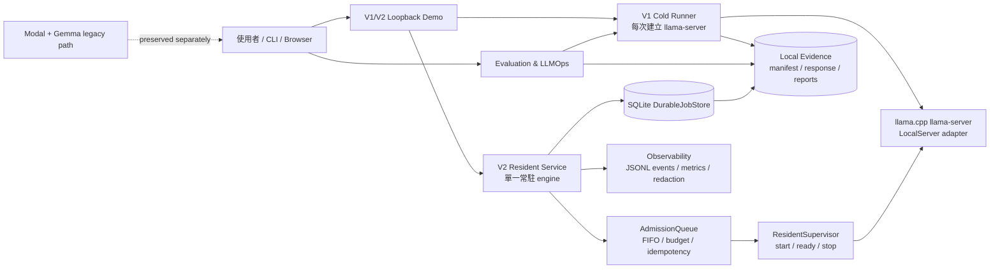
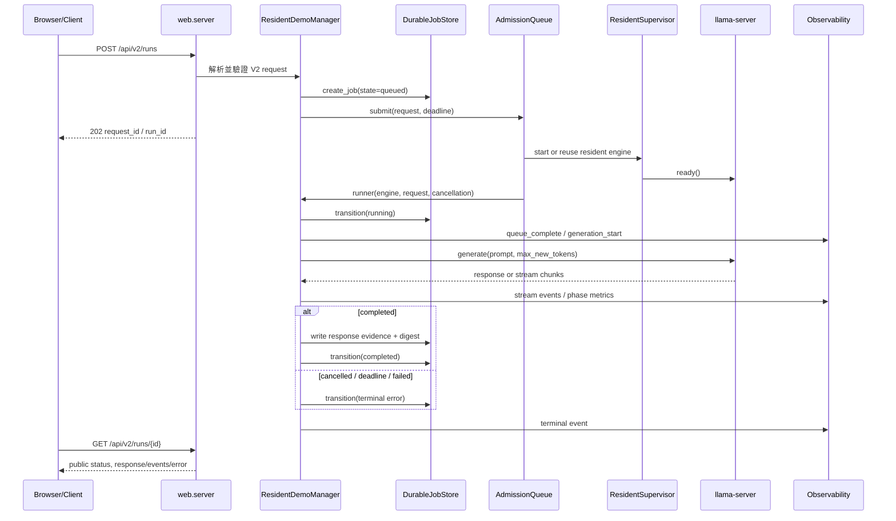

# Modular LLM Serving：本機推論與可復用服務

這是一個「把本機模型跑法整理成可重跑、可比較、可持續開發服務」的 LLM inference lab。它以單機、單張 GPU 為主要驗證場景，使用 Qwen3.8-27B GGUF 與 pinned llama.cpp runtime。

如果只想先抓住重點：**V1 用來做公平的冷啟動比較，V2 用來做可重複呼叫的常駐推論服務；兩者共用模型與 runtime 驗證，但不共用請求協定。**

## 版本與發布狀態

| 版本 | 定位 | 目前狀態 |
| --- | --- | --- |
| `v2.0.0` | Serviceable Inference：V2 resident service、durable jobs、observability、LLMOps gate 與 Demo/API 整合 | 目前正式版本 |
| `v1.0.0` | Local Inference Lab V1：Qwen baseline、24/40 GPU layers 比較與 cold Demo | 已發布、保留相容 |
| Modal/Gemma path | 原有 Modal + Gemma smoke/deployment validation | 保留的獨立 legacy path |

版本 tag 與 release notes 見 [GitHub Releases](https://github.com/DS-Jerry-in-Taiwan/modular-llm-serving/releases)。V2 目前聚焦文字推論服務，尚未涵蓋 Kubernetes、autoscaling、multi-GPU、dynamic batching 或多模態生成。

## 先用白話理解

- **V1 像實驗室的碼表**：每次測試都重新啟動自己的 `llama-server`，跑固定題目，再關閉並保存結果。這樣可以比較 24 層 GPU offload 和 40 層 GPU offload 的差異。
- **V2 像一台已開機的服務櫃台**：模型只啟動一次，之後多個請求排隊進來。服務會記住每個請求的 ID、狀態、取消結果與證據。
- **AdmissionQueue 像入口管制**：它限制同時進來的工作、檢查 token/context 預算，並處理 FIFO、idempotency、deadline 與 cancellation。
- **DurableJobStore 像工作簿**：即使程序重啟，也能知道哪些工作曾經進來、最後停在哪個狀態；它不會假裝把中斷的 generation 接著跑完。
- **Observability 像飛行記錄器**：保存 queue、generation、stream、cleanup、terminal 等事件，但不把 prompt、credential 或 runtime 私密資料送到 public API。
- **LLMOps gate 像驗收門**：只有 identity、evidence、metrics 與 provenance 都符合規則，結果才可以被視為可接受的實驗或版本證據。

## 1. 簡介

### 這個專案解決什麼問題？

它把「在本機跑模型」拆成可以驗證、比較、追蹤與持續迭代的模組：

1. 先驗證模型檔、runtime revision、GPU 與設定是否符合 pinned identity。
2. 用 V1 固定案例取得可重跑的 baseline 與優化比較。
3. 用 V2 resident service 將同一個推論 runtime 變成可重複呼叫的服務。
4. 將每次請求的狀態、事件、證據與 provenance 保存下來，讓後續 LLMOps gate 可以檢查。

### 這個專案目前做到哪裡？

- V2 foundation：38/38 targeted tests
- V2 Demo/API integration：7/7 tests
- 完整回歸：182/182 tests
- Python compilation、JavaScript syntax、diff checks 通過
- `v2.0.0` 已發布；本版本沒有宣稱已完成實體 GPU 推論，GPU 相容性仍須在目標環境驗證

換句話說，測試已證明「模組之間的流程和失敗處理可以工作」，但還不能代替你在實際 12GB GPU 上執行 Qwen3.8-27B 的效能測試。真正的 GPU throughput、VRAM/RAM 使用量和可用 context size，仍要在你的硬體與 driver 上跑 V1/V2 實驗取得。

## 2. 高階架構



### 邊界怎麼看？

- **Browser / CLI** 是輸入端，不直接控制模型程序。
- **Demo/API** 負責 HTTP 邊界、請求格式、loopback 安全與 UI 狀態呈現。
- **V1** 追求可重現比較；每個 variant 都有獨立 process、資源取樣與清理證據。
- **V2** 追求服務化；`ResidentSupervisor` 管一個 engine，`AdmissionQueue` 控制請求何時進入 engine。
- **Evaluation/LLMOps** 讀取已完成的 evidence，不混入任意 live prompt 的品質宣稱。
- **Modal path** 是既有部署驗證契約，不能與本機 Qwen 服務混為同一個 runtime。

## 3. 流程循序圖

以下是 V2 resident 請求從提交到 terminal state 的主要循序：



### 重要的終態規則

1. durable queued state 必須先寫入，避免請求已執行但沒有 ledger。
2. `cleanup` 完成前不能發佈 terminal success。
3. cancellation、deadline、queue-full 與 inference failure 使用不同 error code。
4. public API 不回傳 prompt、credential、runtime path 或 raw provider error。
5. restart 不繼續未完成的 generation；recovery 會依 durable policy 將 incomplete job 收斂成明確狀態。

## 4. 專案模組架構與交互

### 目錄與責任

```text
inference_lab/
├── config.py                 # pinned config/schema validation
├── acquisition.py            # model artifact acquisition + hash verification
├── preflight.py              # read-only readiness checks
├── runtime.py                # owned llama-server process + bounded HTTP
├── telemetry.py              # GPU/host probes and response metrics
├── artifacts.py              # immutable evidence allocation and writes
├── cli.py / __main__.py      # CLI orchestration
├── evaluation/
│   ├── tasks.py              # fixed dataset, filters, review binding
│   ├── baseline.py           # repeated measurements and baseline report
│   └── comparison.py         # identity and single-factor comparison
├── serving/
│   ├── supervisor.py         # one resident engine lifecycle
│   ├── admission.py          # FIFO queue, budgets, deadlines, cancellation
│   ├── streaming.py          # ordered chunks and terminal event
│   └── observability.py      # correlated events, metrics, redaction
├── v2_contracts/             # request/response/event/error schemas
├── llmops/
│   ├── durable.py             # SQLite job ledger and recovery
│   ├── ci_gate.py             # offline acceptance gate
│   └── registry.py            # versioned provenance/lineage
└── web/
    ├── server.py              # /api/*, /api/v2/* and static serving
    ├── jobs.py                # DemoManager + ResidentDemoManager adapters
    └── static/                # browser UI and lifecycle display
```

### 交互關係

| 使用情境 | 主要入口 | 主要模組交互 | 產出 |
| --- | --- | --- | --- |
| V1 固定 benchmark | `python -m inference_lab baseline` | `cli → evaluation.baseline → runtime → telemetry/artifacts` | repeated metrics、report、review evidence |
| V1 Demo | `POST /api/runs` | `web.server → DemoManager → runtime.LocalServer` | variant runs、cleanup receipt |
| V2 resident request | `POST /api/v2/runs` | `web.server → ResidentDemoManager → AdmissionQueue → ResidentSupervisor → engine` | durable job、response/events、terminal state |
| V2 evaluation gate | CI/offline gate | `llmops.ci_gate → durable evidence/registry` | pass/fail gate、provenance report |
| Modal legacy smoke | `modal deploy modal_llama_smoke.py` | Modal image + pinned llama.cpp server | deployment validation evidence |

模組依賴方向由上而下：transport (`web`/CLI) 呼叫 orchestration，orchestration 呼叫 serving/evaluation，底層再共用 `config`、`runtime`、`artifacts` 與 telemetry。V2 不會透過 HTTP 重新接收 model path 或 runtime argument；模型與 runtime identity 由本機設定固定。

## 5. 案例說明

### 案例 A：比較 24 與 40 GPU layers

使用 V1 cold benchmark：

```bash
venv/bin/python -m inference_lab baseline \
  --config experiments/qwen38-27b-q4.json \
  --dataset experiments/tasks-v1.json \
  --binary ~/.cache/inference-lab/runtime/llama-server \
  --model ~/.cache/inference-lab/models/Qwen3.8-27B-Q4_K_M.gguf \
  --output-root docs/local-inference/baseline
venv/bin/python -m inference_lab baseline \
  --config experiments/qwen38-27b-q4-gpu40.json \
  --dataset experiments/tasks-v1.json \
  --binary ~/.cache/inference-lab/runtime/llama-server \
  --model ~/.cache/inference-lab/models/Qwen3.8-27B-Q4_K_M.gguf \
  --output-root docs/local-inference/optimized
```

每次 run 都會驗證 identity、建立自己的 llama-server、執行固定案例、取樣資源、清理 process group，再寫入不可覆寫的 evidence。這條路徑適合回答「哪個設定比較快、耗多少 GPU/RAM」。

### 案例 B：啟動 V2 resident Demo

```bash
venv/bin/python -m inference_lab.web.server --execution-mode resident \
  --state-path docs/local-inference/v2-jobs.sqlite3
```

瀏覽 `http://127.0.0.1:7860/`，選擇 **Warm resident**，送出提示詞。第一次請求會啟動 engine，後續請求重用同一個 engine；UI 會顯示 request/run ID、queue、stream、terminal state 與 metrics。

### 案例 C：V2 API request

```bash
curl -sS -X POST http://127.0.0.1:7860/api/v2/runs \
  -H 'Content-Type: application/json' \
  -d '{"request_id":"demo-001","prompt":"請用一句話說明 resident inference。","max_new_tokens":64,"stream":false}'

curl -sS http://127.0.0.1:7860/api/v2/runs/demo-001
```

V2 request 使用 `max_new_tokens` 與 versioned contract；V1 的 `max_tokens`、`variants` 欄位會被拒絕，避免兩條協定混用。

### 案例 D：取消與 durable recovery

送出一個長請求後呼叫：

```bash
curl -sS -X POST http://127.0.0.1:7860/api/v2/runs/demo-001/cancel \
  -H 'Content-Type: application/json' -d '{}'
```

服務會將 cancellation 傳到 admission handle，等待 runner/cleanup 結束，再把 job 寫成 terminal cancelled。程序重啟時不會假裝續跑未完成 generation，而是依 recovery policy 收斂 durable records，讓 history 可被後續檢查。

### 相關文件

- [V2 serving ADR](docs/architecture/v2-serving-adr.md)
- [Admission / idempotency ADR](docs/architecture/v2-admission-adr.md)
- [Streaming ADR](docs/architecture/v2-streaming-adr.md)
- [LLMOps ADR](docs/architecture/v2-llmops-adr.md)
- [API integration ADR](docs/architecture/v2-integration-api-adr.md)
- [UI integration ADR](docs/architecture/v2-integration-ui-adr.md)
- [Runbook](INFERENCE_LAB.md)
- [Changelog](CHANGELOG.md)
